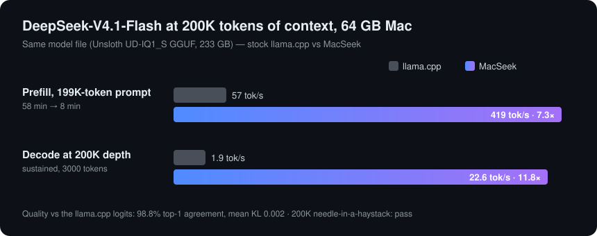

<div align="center">

# MacSeek

**Run DeepSeek-V4.1-Flash with 200K tokens of context on a 64 GB Mac.**

A from-scratch Metal inference engine for one model, tuned end to end:
a 233 GB GGUF served from a 64 GB laptop by streaming mixture-of-experts weights from SSD.

[](#requirements)
[](#how-it-works)
[](#build)
[](#chat-server--api)
[](LICENSE)



</div>

---

## Why

DeepSeek-V4.1-Flash is a 384-expert mixture-of-experts model. Even at Unsloth's 1-bit-class UD-IQ1_S
quant it is **233 GB**, almost four times the memory of a 64 GB Mac. General-purpose runtimes can load it, but they
page experts in through `mmap` faults and crawl: stock llama.cpp needs **58 minutes** to read a 200K-token prompt and
then answers at **under 2 tokens per second**.

MacSeek is written for exactly this model on exactly this kind of machine. It keeps the dense weights on the GPU,
caches the hot experts in a large arena, reads the rest straight from SSD with parallel uncached I/O, and predicts
which experts the next layer will need before it asks for them.

## Results

Same model file, same 64 GB Mac (reference machine: Apple M5 Pro, 20-core GPU), batch size 1.

| | llama.cpp (best working config) | **MacSeek** | |
|---|---:|---:|---:|
| Prefill, full 199K-token prompt | 57.1 tok/s (58 min) | **419 tok/s (8 min)** | **7.3×** |
| Prefill chunk at 199K depth | ~54 tok/s | **425–470 tok/s** | **~8×** |
| Decode at 200K depth, sustained (3,000 tokens) | 1.91 tok/s | **22.6 tok/s** | **11.8×** |
| Decode at 200K depth, first 32 tokens (cold cache) | — | 16 tok/s | |
| 200K needle-in-a-haystack | pass | **pass** | |

Quality is gated against llama.cpp's own logits on a fixed 8-prompt set (2,707 positions): **98.8 % top-1 agreement,
mean KL 0.002**, and 99.0 % on the decode path. The remaining difference comes from accumulation order, not
approximation. Runs are bit-reproducible: the same prompt gives the same tokens every time.

Full methodology and raw numbers: [docs/modules/oracle.md](docs/modules/oracle.md).

## Highlights

- **Written from scratch.** C++20, Objective-C++ and Metal Shading Language 4. No llama.cpp or ggml code in the engine;
  llama.cpp is used only as a correctness oracle and speed baseline.
- **Expert streaming that keeps up with the GPU.** Slot-arena expert cache sized from free memory, scan-resistant
  eviction, 8–16 thread `F_NOCACHE` reads at ~15 GB/s, next-layer expert prediction, and a GPU-side table so a whole
  token runs in one command buffer.
- **Hand-written Metal kernels** for every quant in the file (IQ1_S, IQ2_XXS, IQ4_NL, Q5_K, Q6_K, Q8_0, BF16),
  including register-dequant grouped MoE GEMMs on the Metal 4 tensor API.
- **Long-context attention** for DeepSeek's sparse/compressed attention: lightning indexer, top-k selection over
  200K positions, candidate-block pruning and a pipelined two-pass sparse attention for prefill.
- **Engram** n-gram memory (a 103 GB lookup table) fetched row by row from SSD, one chunk ahead.
- **Instant follow-ups.** State snapshots let a chat turn prefill only the new tokens; a 200K context can be saved
  and reloaded bit-exactly.
- **OpenAI-compatible server** with streaming, tool calls, reasoning content, and a built-in web chat UI.
- **Every optimization is switchable.** Each one sits behind a `MACSEEK_*` env var with the simple, correct path
  as a fallback.

## Requirements

- Apple Silicon Mac with **64 GB** of unified memory and a fast internal SSD (tuned on an M5 Pro; other chips are
  untested)
- **macOS 26 or newer** (Metal 4). Xcode command line tools, CMake ≥ 3.26, Ninja (`brew install cmake ninja ccache`).
  The offline Metal compiler is not needed.
- About **240 GB** of free disk for the model
- Optional, for the correctness and baseline tools only: Homebrew `llama.cpp`, Python 3

## Get the model

```sh
pip install -U huggingface_hub
hf download unsloth/DeepSeek-V4.1-Flash-1017-GGUF --include "UD-IQ1_S/*" \
  --revision 8a6ec9cf118e785a362ea94ee123c61c70553be6
```

MacSeek looks in the standard Hugging Face cache (`$HF_HUB_CACHE`, `$HF_HOME/hub` or `~/.cache/huggingface/hub`).
If you keep the files somewhere else, point to them:

```sh
export MACSEEK_MODEL_DIR=/path/to/UD-IQ1_S        # folder with the 5 split files
# or: export MACSEEK_MODEL=/path/to/...-00001-of-00005.gguf
```

## Build

```sh
git clone https://github.com/arnavprabhu/MacSeek.git && cd MacSeek
cmake -S . -B build -G Ninja -DCMAKE_BUILD_TYPE=Release
ninja -C build
(cd build && ctest)          # kernel and module tests (synthetic data, no model needed for most)
```

## Chat server + API

```sh
tools/serve.sh               # builds if needed, loads the model (~10 s), serves http://127.0.0.1:8080
```

Open http://127.0.0.1:8080 for the web chat, or use any OpenAI client:

```sh
curl http://127.0.0.1:8080/v1/chat/completions -H 'Content-Type: application/json' -d '{
  "model": "deepseek-v4.1-flash",
  "messages": [{"role": "user", "content": "Explain mixture-of-experts in two sentences."}],
  "stream": true
}'
```

Supports `/v1/chat/completions` (streaming, tools, `reasoning_content`), `/v1/completions`, `/v1/models`,
`/health`, `/props` and live engine stats at `/v1/stats`. Sampling: temperature, top_p, top_k, min_p, penalties,
seed, stop, logit_bias. Thinking mode: `reasoning_effort` or `chat_template_kwargs.thinking_mode`.
Details: [docs/serve.md](docs/serve.md).

Other commands: `macseek tokenize | detok | chat-format | gen | bench | logits | snapshot` (run `build/macseek`
for usage). Only one process should load the model at a time; the tools take a lock (`tools/modellock.sh`).

## How it works

Per decode token, ~5.9 GB of dense weights (attention, shared expert, router, output head) stay resident on the GPU.
Each of the 40 layers routes to 6 of 384 experts; the router result is handed to the CPU once per layer, cache hits
cost nothing, and misses are read from SSD in parallel while the GPU runs the shared expert. A predictor uses the
next layers' routers on the current hidden state to prefetch likely experts early. Prefill runs 4K-token chunks: all
experts a chunk touches are streamed through a ring while grouped GEMMs run on whatever is already resident.

| Doc | Covers |
|---|---|
| [SPEC.md](SPEC.md) | Model facts, forward pass, module interfaces, memory plan, correctness gates |
| [docs/integration.md](docs/integration.md) | Decode and prefill schedules |
| [docs/modules/store.md](docs/modules/store.md) | Expert cache, SSD streaming, engram rows, memory sizing |
| [docs/modules/quant.md](docs/modules/quant.md) | Quantized matvec / GEMM / MoE kernels |
| [docs/modules/attn.md](docs/modules/attn.md) | Sparse attention, indexer, compressed KV at 200K |
| [docs/modules/arch.md](docs/modules/arch.md) | Hyper-connections, router, engram, sampling |
| [docs/modules/dec_gpu.md](docs/modules/dec_gpu.md), [dec_sync.md](docs/modules/dec_sync.md) | Decode kernel fusion and CPU/GPU handshake |
| [docs/modules/tok.md](docs/modules/tok.md) | Tokenizer, chat template, HTTP server |
| [docs/modules/oracle.md](docs/modules/oracle.md) | Correctness oracle, quality gate, llama.cpp baseline |
| [docs/speculative.md](docs/speculative.md) | Why speculative decoding does not pay off here (measured) |

## Repository layout

```
src/core      Metal device, buffers, env flags        src/model    DS4.1 forward pass, decode/prefill, snapshots
src/gguf      GGUF parser                             src/tok      tokenizer, chat template, JSON
src/store     expert cache, SSD I/O, engram rows      src/server   OpenAI-compatible HTTP + SSE
src/kernels   Metal kernels + host encoders           src/app      macseek CLI
tests/        per-module tests + CPU references       bench/       microbenchmarks
tools/        quality gate, oracle, serve scripts     web/         chat UI
```

## Correctness

Three gates: every kernel has a CPU reference and a ctest; algorithm invariants (chunked prefill equals one-shot,
snapshot round trips are bit-exact); and a model-level gate that compares full logits at every position against
the pinned baseline, plus a 200K needle test and a sustained decode run. See SPEC.md §6.

## Acknowledgements

- [DeepSeek-AI](https://huggingface.co/deepseek-ai) for DeepSeek-V4.1-Flash and its reference implementation
  (in `reference/`, MIT)
- [Unsloth](https://huggingface.co/unsloth) for the UD-IQ1_S dynamic quant
- [llama.cpp](https://github.com/ggml-org/llama.cpp), used as the correctness oracle and baseline

## License

[MIT](LICENSE)
